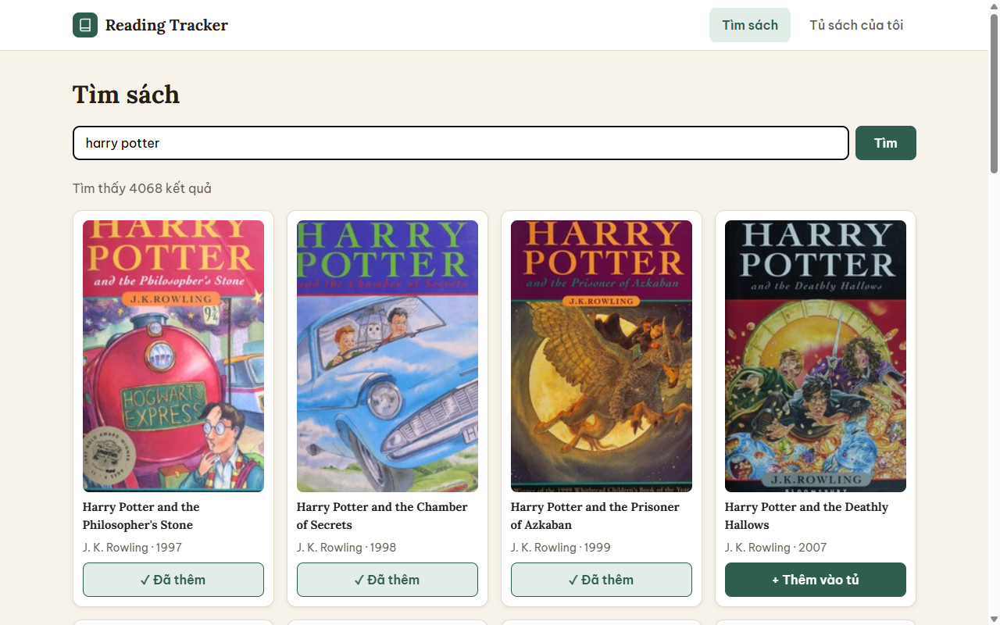
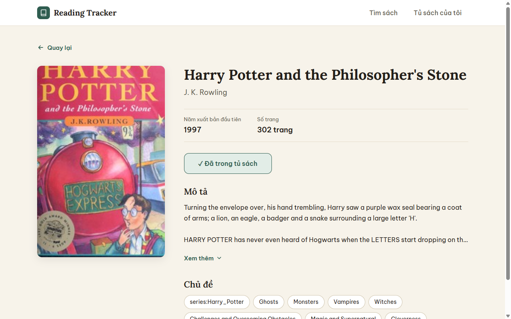
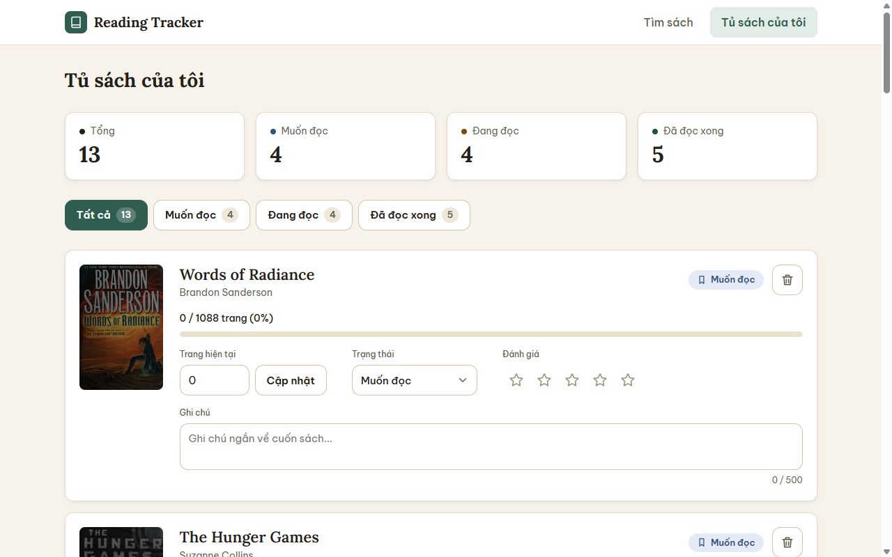
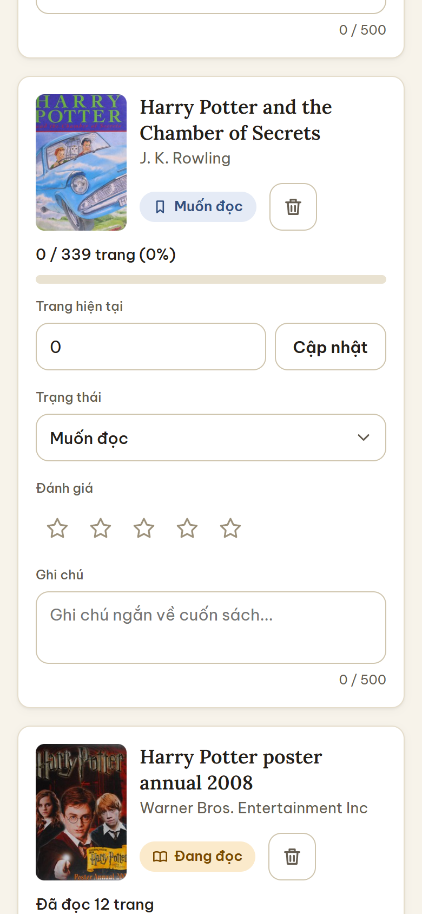
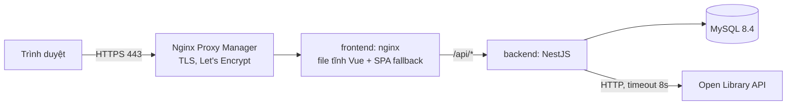
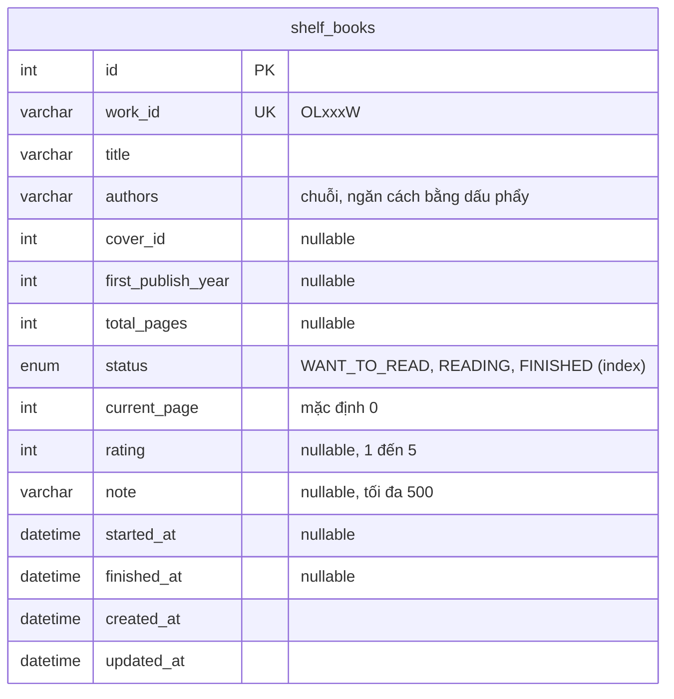

# Mini Reading Tracker

Ứng dụng quản lý tủ sách cá nhân: tìm sách trên [Open Library](https://openlibrary.org), thêm vào tủ, theo dõi tiến độ đọc (số trang, trạng thái), chấm điểm và ghi chú.

| | |
|---|---|
| **Frontend (demo)** | https://icode-reading-tracker.vinhhv28.site |
| **Backend API** | https://icode-reading-tracker.vinhhv28.site/api |
| **Swagger** | https://icode-reading-tracker.vinhhv28.site/api/docs |
| **Mã nguồn** | https://github.com/VinHa28/mini-reading-tracker |

## Ảnh chụp màn hình

| Tìm sách | Chi tiết sách |
|---|---|
|  |  |

| Tủ sách (desktop) | Tủ sách (mobile) |
|---|---|
|  |  |

## Tính năng

- Tìm sách theo tên hoặc tác giả, phân trang, hiện sẵn gợi ý khi mở trang. Sách đã có trong tủ được đánh dấu "Đã thêm".
- Trang chi tiết: mô tả, chủ đề, năm xuất bản, số trang.
- Thêm vào tủ, thêm trùng thì báo "đã có trong tủ" (API trả `409`).
- Tủ sách có thống kê, lọc theo trạng thái (Muốn đọc / Đang đọc / Đã đọc xong), cập nhật trang đang đọc, đổi trạng thái, chấm sao 1 đến 5, ghi chú tối đa 500 ký tự, xóa khỏi tủ (có hộp xác nhận).
- Sách không có ảnh bìa hiển thị bìa giả (màu cố định theo tên sách).
- Giao diện responsive (desktop và mobile), thông báo (toast) cho mọi thao tác thành công hoặc lỗi.

## Công nghệ

| Phần | Công nghệ |
|---|---|
| Frontend | Vue 3 (Composition API, `<script setup>`), TypeScript, Vite, Vue Router, Pinia, Axios |
| Backend | NestJS 11, TypeORM, `class-validator`, `@nestjs/swagger`, `@nestjs/axios` |
| CSDL | MySQL 8.4 |
| Dữ liệu sách | Open Library (backend gọi, frontend **không** gọi trực tiếp) |
| Triển khai | Docker Compose, nginx, Nginx Proxy Manager, Let's Encrypt |
| Kiểm thử | Jest (49 unit test cho luật nghiệp vụ) |

## Kiến trúc



Chỉ lớp ngoài cùng (NPM) mở cổng 80 và 443. Frontend, backend và MySQL nằm trong mạng Docker nội bộ. Trình duyệt chỉ nói chuyện với một origin nên không cần CORS.

### Cấu trúc thư mục

```
.
├── backend/               NestJS
│   └── src/
│       ├── books/         tìm kiếm và chi tiết sách (proxy Open Library)
│       ├── open-library/  client gọi Open Library, map lỗi upstream
│       ├── shelf/         tủ sách: CRUD, thống kê, luật nghiệp vụ (shelf-rules.ts)
│       ├── common/        filter lỗi dùng chung
│       ├── migrations/    migration TypeORM
│       └── database/      data-source, seed
├── frontend/              Vue 3
│   └── src/
│       ├── api/           axios client + hàm gọi API
│       ├── components/    BookCard, ShelfItem, ConfirmDialog, ToastHost...
│       ├── stores/        Pinia: shelf, toast
│       ├── views/         Search, BookDetail, Shelf, NotFound
│       └── router/
├── design/                bản thiết kế giao diện (HTML + tokens)
├── docs/screenshots/      ảnh trong README
└── docker-compose.yml     mysql + backend + frontend
```

### Sơ đồ cơ sở dữ liệu

Một bảng duy nhất vì đề chỉ có một người dùng và dữ liệu sách lấy từ Open Library.



- `work_id` có **unique index**: chống thêm trùng ngay ở tầng CSDL. Hai request đồng thời cùng thêm một sách thì request sau bị lỗi `ER_DUP_ENTRY` và được bắt thành `409`, không cần kiểm tra "có chưa" trước (tránh race condition).
- Metadata sách (tên, tác giả, số trang) do **backend** lấy từ Open Library khi thêm, không tin dữ liệu frontend gửi lên.

## Chạy trên máy (local)

Yêu cầu: Node 22+, Docker.

### Cách 1: chạy toàn bộ bằng Docker (giống môi trường deploy)

```bash
cp .env.example .env            # đổi mật khẩu nếu muốn
docker compose up -d --build
```

Mở http://localhost:8080. Backend tự chạy migration khi khởi động. Nạp sách mẫu (tùy chọn):

```bash
docker compose exec backend node dist/database/seed.js
```

### Cách 2: chạy riêng từng phần để phát triển

```bash
# 1) MySQL (cổng 3307 trên máy)
cp .env.example .env            # đặt MYSQL_PORT=3307 trong file này
docker compose up -d mysql

# 2) Backend (http://localhost:3000)
cd backend
cp .env.example .env            # DB_PORT=3307 khớp MYSQL_PORT ở trên
npm install
npm run migration:run           # tạo bảng
npm run seed                    # (tùy chọn) nạp 13 sách mẫu đủ 3 trạng thái
npm run start:dev

# 3) Frontend (http://localhost:5173, tự proxy /api sang backend)
cd frontend
npm install
npm run dev
```

Tài liệu API khi chạy local: http://localhost:3000/api/docs

### Biến môi trường

| Biến | Ở đâu | Ý nghĩa |
|---|---|---|
| `MYSQL_ROOT_PASSWORD`, `MYSQL_DATABASE`, `MYSQL_USER`, `MYSQL_PASSWORD`, `MYSQL_PORT` | `.env` gốc | Cấu hình MySQL và mật khẩu cho backend (Compose truyền vào) |
| `WEB_PORT` | `.env` gốc | Cổng frontend trên máy chủ (mặc định 8080, chỉ nghe `127.0.0.1`) |
| `SWAGGER_ENABLED` | `.env` gốc / backend | `false` để ẩn `/api/docs` |
| `DB_HOST`, `DB_PORT`, `DB_USER`, `DB_PASSWORD`, `DB_NAME`, `PORT`, `CORS_ORIGIN` | `backend/.env` | Chỉ dùng khi chạy backend trực tiếp trên máy (trong Docker do Compose đặt) |
| `VITE_API_URL`, `DEV_PROXY_TARGET` | `frontend/.env.development` | Địa chỉ API và đích proxy khi chạy `npm run dev` |

Không có file `.env` nào được commit; chỉ có `.env.example`.

## API

Tiền tố `/api`. Mọi lỗi (kể cả lỗi validate và lỗi không lường trước) đều có cùng một dạng; `details` chỉ xuất hiện khi lỗi validate, chứa danh sách từng trường sai:

```json
{ "statusCode": 409, "error": "Conflict", "message": "Sách này đã có trong tủ", "path": "/api/shelf", "timestamp": "2026-10-18T06:00:00.000Z" }
```

| Method | Đường dẫn | Mô tả |
|---|---|---|
| GET | `/api/books/search?q=&page=` | Tìm sách trên Open Library, trả `{ items, total, page, pageSize }`; mỗi sách có `inShelf` |
| GET | `/api/books/:workId` | Chi tiết sách (thêm `description`, `subjects`) |
| POST | `/api/shelf` | Thêm sách vào tủ (`workId`, `status` tùy chọn). Trùng: **409** |
| GET | `/api/shelf?status=` | Danh sách tủ sách, lọc theo trạng thái |
| GET | `/api/shelf/stats` | Thống kê: tổng và theo từng trạng thái |
| GET | `/api/shelf/:id` | Một sách trong tủ |
| PATCH | `/api/shelf/:id` | Cập nhật `currentPage`, `status`, `rating` (1 đến 5 hoặc `null`), `note` (tối đa 500 hoặc `null`) |
| DELETE | `/api/shelf/:id` | Xóa khỏi tủ |

Chi tiết tham số và ví dụ: Swagger tại `/api/docs`.

### Luật nghiệp vụ khi cập nhật (`PATCH /api/shelf/:id`)

- `0 ≤ currentPage ≤ totalPages`, vượt quá thì **400**.
- Đọc đến trang cuối thì tự chuyển `FINISHED` và ghi `finishedAt`.
- Nhập số trang > 0 khi đang `WANT_TO_READ` thì tự chuyển `READING`; `startedAt` chỉ được ghi một lần.
- Đang `FINISHED` mà lùi số trang thì quay lại `READING` và xóa `finishedAt`.
- Đặt trạng thái `FINISHED` kèm số trang nhỏ hơn tổng thì **400**; đặt `FINISHED` không kèm trang thì `currentPage` được đặt bằng `totalPages`.
- Phải gửi ít nhất một trường cần cập nhật.

Các luật này nằm trong hàm thuần `backend/src/shelf/shelf-rules.ts` và được kiểm thử bằng Jest.

## Triển khai

Đã triển khai trên một VPS Ubuntu 22.04 bằng Docker Compose, HTTPS qua Nginx Proxy Manager và Let's Encrypt.

1. Trỏ bản ghi DNS `A` của `icode-reading-tracker.vinhhv28.site` về IP VPS.
2. Cài Docker, mở tường lửa chỉ cho SSH, 80 và 443 (`ufw`).
3. `git clone`, tạo `.env` với mật khẩu ngẫu nhiên (`openssl rand -hex 16`), rồi `docker compose up -d --build`. Compose khởi động theo thứ tự `mysql` (healthy) → `backend` (chạy migration, healthy) → `frontend`.
4. Chạy Nginx Proxy Manager trong một stack riêng, nối chung mạng Docker `proxy` với frontend. Trong trang quản trị tạo Proxy Host: domain → `reading-tracker-frontend:80`, xin chứng chỉ Let's Encrypt, bật Force SSL.
5. Cập nhật: `git pull && docker compose up -d --build`. Dữ liệu nằm trong volume `mysql_data`, không dùng `down -v`.

Điểm cần lưu ý:
- Frontend publish cổng ở `127.0.0.1` (cổng publish của Docker đi vòng qua `ufw`). MySQL và trang quản trị NPM cũng chỉ nghe `127.0.0.1`.
- `frontend/nginx.conf.template` dùng `envsubst` để trỏ `/api` tới backend; file build của Vite có mã băm trong tên nên cache 1 năm, `index.html` thì không cache.
- Mật khẩu CSDL nằm trong `.env` trên máy chủ, không nằm trong mã nguồn hay ảnh Docker.

## Giả định, hạn chế và hướng cải thiện

**Giả định**
- Chỉ có một người dùng, không đăng nhập.
- Sách được xác định bằng `workId` của Open Library (một "tác phẩm", không phân biệt từng ấn bản).
- Sách không có số trang (`totalPages = null`): vẫn thêm được, hiển thị "Đã đọc N trang" và không có thanh phần trăm. Không thể tự chuyển sang `FINISHED` theo số trang, người dùng đổi trạng thái thủ công.

**Hạn chế**
- Chưa có cache cho kết quả Open Library, mỗi lần tìm đều gọi API ngoài (timeout 8 giây; lỗi upstream trả 502, quá hạn trả 504). Open Library đôi khi trả ảnh bìa chậm.
- Chưa giới hạn tần suất gọi (rate limit) cho API.
- Phân trang kết quả tìm chỉ có "Trước/Sau" (từ khóa phổ biến có hàng nghìn trang).
- Chưa có test e2e và chưa có test cho frontend; hiện có 49 unit test cho backend.
- Trường `authors` của tủ sách lưu dạng chuỗi, chưa tách bảng tác giả.
- Chưa có CI/CD, deploy bằng tay qua SSH.

**Hướng cải thiện**
- Cache kết quả tìm kiếm (bộ nhớ hoặc Redis) và rate limit bằng `@nestjs/throttler`.
- Thêm xác thực nhiều người dùng, mỗi người một tủ sách riêng.
- Test e2e (Playwright) và test component (Vitest) cho frontend.
- CI chạy lint, test, build ảnh Docker; tự động deploy khi merge vào `main`.
- Sao lưu định kỳ volume MySQL.

## Kiểm thử

```bash
cd backend
npm test            # unit test (49 test)
npm run lint
cd ../frontend
npm run type-check
```
